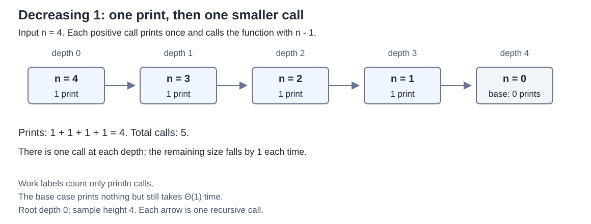
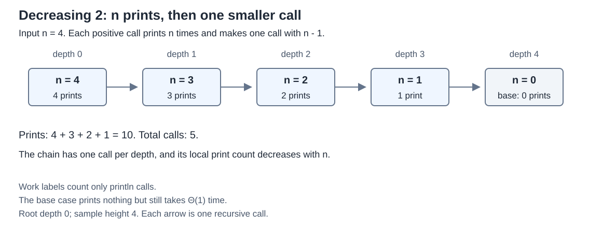
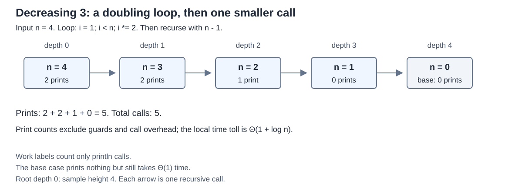
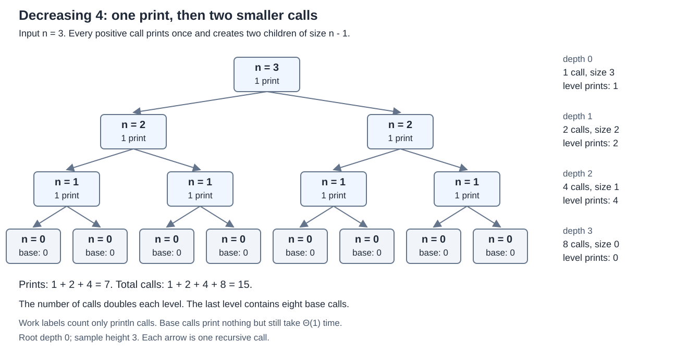
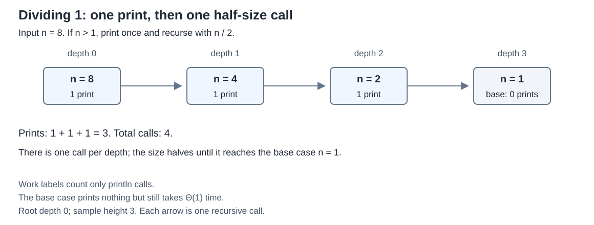
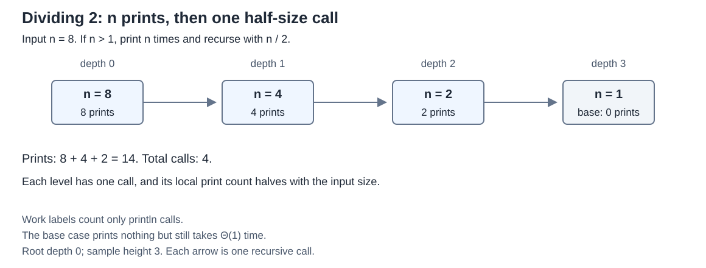
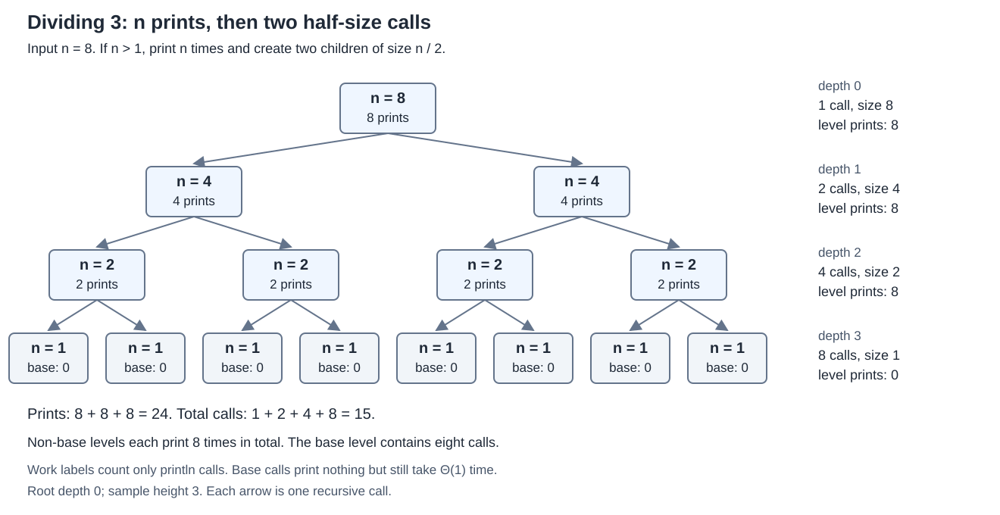

# DAA coursework

## Recurrence Relations and Master Theorem

This coursework analyzes four decreasing functions and three dividing functions. For each function, I explain the work done in one call, write its recurrence, solve it, and check the result using the appropriate theorem or expansion rule.

The project title follows the assignment. The GitHub repository is named `DAA-coursework` because repository names cannot contain spaces. This follows [GitHub's naming rules](https://docs.github.com/en/repositories/creating-and-managing-repositories/creating-a-new-repository).

## Assumptions

`T(n)` represents the running time for input size `n`. I count each print, comparison, and arithmetic operation as constant work, as in the assignment. Actual console speed is not what the analysis measures.

All logarithms are base 2. I use `Theta` for a tight bound, meaning the upper and lower bounds have the same growth rate. Each result also gives the corresponding Big-O bound.

A base call takes a positive constant time `c`, even though it prints nothing. The decreasing functions stop at `n = 0`. The dividing functions stop at `n <= 1`. Equations such as `+1` and `+n` are simplified cost models; they leave out constant factors and smaller terms.

Recursion depth means the number of edges from the first call to a base call. The number of stack frames on that path is depth plus one. For the dividing calculations, I first use `n = 2^L` to avoid rounding. Java uses integer division, and I discuss that below.

## Task 1. Decreasing functions

### The rule for decreasing recurrences

The required form is:

```text
T(n) = aT(n - b) + f(n)
```

Here, `a` is the number of recursive calls, `b` is the fixed amount removed from the input, and `f(n)` is the work outside those calls. In this task, `b = 1`.

The classical dividing Master Theorem does not directly apply to `n - b`. For this task, I use the decreasing expansion rule. Expanding the recurrence gives:

```text
T(n) = aT(n - b) + f(n)
     = a^2 T(n - 2b) + a f(n - b) + f(n)
     = a^h T(n - hb) + sum from i = 0 to h - 1 of a^i f(n - ib)
```

With a base case at `n <= 0`, the depth is `h = ceil(n / b)`. This formula explains the cases rather than relying on the dividing theorem's case numbers. The distinction is also discussed in the [MIT notes on recurrences](https://ocw.mit.edu/courses/6-006-introduction-to-algorithms-spring-2020/1869dbf640ded6b31f1bd369d2001ef5_MIT6_006S20_r03.pdf).

For fixed `b > 0`, constant positive base cost, and nonnegative local work of the form `Theta(n^k)`, `k >= 0`, or `Theta(1 + log n)`, the cases are:

| Decreasing case | Condition | Result |
| --- | --- | --- |
| D1 | 0 < a < 1 | Theta(f(n)) |
| D2 | a = 1 | Add the work over the decreasing input sizes |
| D3 | a > 1 | Theta(a^(n/b)) |

D1 is an algebraic case, because a fraction cannot be the number of recursive calls. None of the given functions uses it. In D2, polynomial work `n^k` sums to `Theta(n^(k+1))`, while logarithmic work sums to `Theta(n log n)`.

In D3, there are exponentially many small calls near the bottom. For example, with `b = 1`, the expansion can be rewritten as:

```text
T(n) = a^n [c + sum from j = 1 to n of f(j) / a^j]
```

For polynomial or logarithmic `f`, the sum stays bounded as `n` grows, so the result is `Theta(a^n)`. These case rules are not a claim about every possible `f(n)`; faster-growing work would need a separate analysis.

### Function 1. T(n) = T(n - 1) + 1

Code: `DecreasingFunctions.printOnce`.

The function prints once and then calls itself with `n - 1`. There is one recursive call, so `a = 1`. The input decreases by one, so `b = 1`. The local work is constant, represented by `f(n) = 1`.

```text
T(n) = T(n - 1) + 1
     = T(n - 2) + 2
     = T(n - 3) + 3
     = T(0) + n
     = c + n
```

The tree is a single chain. At each non-base level there is one call and constant local work. The chain has `n` edges and `n + 1` calls including the base case.



For `n = 4`, the printed values are `4, 3, 2, 1`. The call with `n = 0` returns without printing.

Decreasing case D2 applies. With `k = 0`, adding constant work over `n` calls gives `Theta(n)`. This matches the manual result `c + n`.

**Time complexity: O(n), with tight bound Theta(n).** Depth is `n`, so the extra recursive stack space is `Theta(n)`.

### Function 2. T(n) = T(n - 1) + n

Code: `DecreasingFunctions.printNTimes`.

The loop runs `n` times, then the function makes one call with `n - 1`. Therefore, `a = 1`, `b = 1`, and `f(n) = n` in the simplified model.

```text
T(n) = T(n - 1) + n
     = T(n - 2) + (n - 1) + n
     = T(n - 3) + (n - 2) + (n - 1) + n
     = c + 1 + 2 + ... + n
     = c + n(n + 1) / 2
```

There is one call at each level. At level `i`, the input size and the local loop work are both `n - i`, until the base case. The depth is `n`.



For `n = 4`, the function prints 4 four times, 3 three times, 2 twice, and 1 once. This is `4 + 3 + 2 + 1 = 10` prints.

Decreasing case D2 applies with `k = 1`. Summing linear work over decreasing sizes gives `Theta(n^2)`. The formula `n(n + 1) / 2` gives the same result.

**Time complexity: O(n^2), with tight bound Theta(n^2).** Extra stack space is `Theta(n)`.

### Function 3. T(n) = T(n - 1) + log n

Code: `DecreasingFunctions.printWithDoublingLoop`.

The loop counter takes the values `1, 2, 4, 8, ...` while it is smaller than `n`. Doubling the counter makes the loop logarithmic. However, the recursive argument is still `n - 1`, not `n / 2`.

Here, `a = 1`, `b = 1`, and the dominant local work is `f(n) = log n`. The actual loop makes `ceil(log n)` iterations for positive `n`. At `n = 1` it makes none, but the guard and recursive call still take constant work. More precisely, local time is `Theta(1 + log n)`.

Using the assignment's logarithmic cost model:

```text
T(n) = T(n - 1) + log n
     = T(n - 2) + log(n - 1) + log n
     = c + log 1 + log 2 + ... + log n
     = c + log(n!)
```

For an upper bound, each term is at most `log n`, so the sum is at most `n log n`. For a lower bound, at least half of the terms have an argument at least `n / 2`. Their sum is at least `(n / 2) log(n / 2)`. Together, these bounds give `Theta(n log n)`. Rounding loop counts and adding the constant work of each call do not change this bound.

The tree is a chain of depth `n`. At level `i`, there is one call of size `n - i`, with local time `Theta(1 + log(n - i))` for a positive input.



For `n = 4`, the loops at sizes `4, 3, 2, 1` print `2, 2, 1, 0` times. The full output is `4, 4, 3, 3, 2`, giving five prints. The diagrams count actual prints, not the constant guard and call work.

Decreasing case D2 applies to logarithmic work. Summing that work gives `Theta(n log n)`, matching the manual upper and lower bounds.

**Time complexity: O(n log n), with tight bound Theta(n log n).** Extra stack space is `Theta(n)`.

### Function 4. T(n) = 2T(n - 1) + 1

Code: `DecreasingFunctions.callTwice`.

The function prints once and makes two calls with `n - 1`. Both calls are executed, even though their arguments are equal. Therefore, `a = 2`, `b = 1`, and `f(n) = 1`.

```text
T(n) = 2T(n - 1) + 1
     = 4T(n - 2) + 3
     = 8T(n - 3) + 7
     = 2^k T(n - k) + (2^k - 1)
     = 2^n c + (2^n - 1)
```

The number of calls doubles at every level:

| Level | Calls | Input per call | Prints at the level |
| --- | --- | --- | --- |
| 0 | 1 | n | 1 |
| 1 | 2 | n - 1 | 2 |
| i < n | 2^i | n - i | 2^i |
| n | 2^n | 0 | 0, but each base call takes constant time |

There are `1 + 2 + ... + 2^(n-1) = 2^n - 1` prints and `2^(n+1) - 1` total calls. The height is `n`.



For `n = 3`, depth-first execution prints `3, 2, 1, 1, 2, 1, 1`. Seven nodes print, and eight base calls print nothing.

Decreasing case D3 applies because `a = 2 > 1` and the local work is constant. It gives `Theta(2^n)`, which agrees with the expansion.

**Time complexity: O(2^n), with tight bound Theta(2^n).** Extra stack space is only `Theta(n)`: the two branches run one after the other, so the whole tree is not kept on the stack at once.

### Comparison of the decreasing functions

| Function | Time | Depth | Decreasing case |
| --- | --- | --- | --- |
| 1 | Theta(n) | n | D2, constant work |
| 2 | Theta(n^2) | n | D2, linear work |
| 3 | Theta(n log n) | n | D2, logarithmic work |
| 4 | Theta(2^n) | n | D3, two calls |

All four functions have the same depth, but their total work differs. For large `n`, their growth from slowest to fastest is Function 1, Function 3, Function 2, then Function 4. Depth alone is not enough to determine time complexity.

## Task 2. Dividing functions

### Master Theorem for dividing recurrences

The required form is:

```text
T(n) = aT(n / b) + f(n)
```

Here, `a >= 1` counts the recursive calls, `b > 1` is the division factor, and `f(n)` is the local work. Both `a` and `b` are fixed constants. Define `p = log_b a`. In the basic three cases:

| Case | Condition | Result |
| --- | --- | --- |
| 1 | f(n) = O(n^(p - epsilon)) for some epsilon > 0 | Theta(n^p) |
| 2 | f(n) = Theta(n^p) | Theta(n^p log n) |
| 3 | f(n) = Omega(n^(p + epsilon)), and a f(n/b) <= c f(n) for some fixed 0 < c < 1 | Theta(f(n)) |

Case 1 is dominated by the leaves. In Case 2, the levels have comparable work. Case 3 is dominated by the top levels; its extra condition ensures that the work decreases geometrically. I use the case definitions from the [MIT Master Theorem notes](https://ocw.mit.edu/courses/6-006-introduction-to-algorithms-spring-2020/1869dbf640ded6b31f1bd369d2001ef5_MIT6_006S20_r03.pdf).

For a recursion tree, level `i` has `a^i` calls of size `n / b^i`. Its work is `a^i f(n / b^i)`. The height is `log_b n` when the sizes reach 1 exactly. Base calls also contribute constant time each.

### Function 1. T(n) = T(n/2) + 1

Code: `DividingFunctions.printOnce`.

One value is printed, followed by one call with `n / 2`. Therefore, `a = 1`, `b = 2`, and `f(n) = 1`.

```text
T(n) = T(n/2) + 1
     = T(n/4) + 2
     = T(n/8) + 3
     = T(n/2^k) + k
```

The base size is 1, so `n / 2^k = 1` and `k = log n`. Thus `T(n) = c + log n`.

| Level | Calls | Input per call | Local work at the level |
| --- | --- | --- | --- |
| 0 | 1 | n | 1 |
| i < L | 1 | n / 2^i | 1 |
| L = log n | 1 | 1 | Constant base work, no prints |



For `n = 8`, the calls have sizes `8, 4, 2, 1`. Only the first three print. There are three edges and four calls.

For the Master Theorem, `p = log_2 1 = 0`, so `n^p = 1`. The local work has the same growth as 1, which is Case 2. The result is `Theta(log n)`, matching the expansion and tree.

**Time complexity: O(log n), with tight bound Theta(log n).** Depth is `log n` for powers of two, and extra stack space is `Theta(log n)`.

### Function 2. T(n) = T(n/2) + n

Code: `DividingFunctions.printNTimes`.

The loop prints `n` times, then makes one call with `n / 2`. Therefore, `a = 1`, `b = 2`, and `f(n) = n`.

```text
T(n) = T(n/2) + n
     = T(n/4) + n/2 + n
     = T(n/8) + n/4 + n/2 + n
     = c + n + n/2 + n/4 + ... + 2
```

Let `L = log n`. This is a geometric sum:

```text
sum from i = 0 to L - 1 of n/2^i
    = n(1 - (1/2)^L) / (1 - 1/2)
    = 2n - 2

T(n) = c + 2n - 2
```

| Level | Calls | Input per call | Local work at the level |
| --- | --- | --- | --- |
| 0 | 1 | n | n |
| 1 | 1 | n/2 | n/2 |
| i < L | 1 | n / 2^i | n / 2^i |
| L | 1 | 1 | Constant base work, no prints |



For `n = 8`, the non-base loops print `8 + 4 + 2 = 14` times. The depth is three. The loop at the root does most of the work.

For the Master Theorem, `p = 0` and `f(n) = n` grows polynomially faster than `n^0 = 1`. Case 3 applies with `epsilon = 1`. Its regularity condition holds because `a f(n/b) = n/2 <= (1/2) f(n)`, and `1/2 < 1`.

The theorem gives `Theta(n)`, matching the geometric sum.

**Time complexity: O(n), with tight bound Theta(n).** Extra stack space is `Theta(log n)`.

### Function 3. T(n) = 2T(n/2) + n

Code: `DividingFunctions.callTwiceWithLoop`.

The loop prints `n` times, then makes two calls with `n / 2`. Therefore, `a = 2`, `b = 2`, and `f(n) = n`.

| Level | Calls | Input per call | Local work at the level |
| --- | --- | --- | --- |
| 0 | 1 | n | n |
| 1 | 2 | n/2 | 2(n/2) = n |
| 2 | 4 | n/4 | 4(n/4) = n |
| i < L | 2^i | n / 2^i | n |
| L = log n | n | 1 | Theta(n) total base work, no prints |



Every non-base level has total work `n`, and there are `L = log n` such levels. The `n` base calls together take `n c` time in the simplified model. Therefore:

```text
T(n) = n log n + n c
```

The expansion gives the same answer:

```text
T(n) = 2T(n/2) + n
     = 4T(n/4) + 2n
     = 8T(n/8) + 3n
     = 2^k T(n/2^k) + kn
```

At `k = log n`, this becomes `n c + n log n`.

For `n = 8`, the first three levels each print eight times, giving 24 prints. The last level contains eight base calls. The height is three, and the total number of calls is 15.

For the Master Theorem, `p = log_2 2 = 1`. Since `f(n) = n = Theta(n^p)`, Case 2 applies. It gives `Theta(n log n)`, matching both the tree and the expansion.

**Time complexity: O(n log n), with tight bound Theta(n log n).** Extra stack space is `Theta(log n)` because the two branches execute sequentially.

### Integer division and comparison

For any positive integer input, the size at level `i` is `floor(n / 2^i)`, and the depth is `floor(log n)`. For example, `7 -> 3 -> 1` has depth two. Rounding does not change the asymptotic results. In Function 3, each non-base level still has total loop work between `n/2` and `n`, so the total remains `Theta(n log n)`.

| Function | Time | Depth for positive n | Master Theorem case |
| --- | --- | --- | --- |
| 1 | Theta(log n) | floor(log n) | Case 2 |
| 2 | Theta(n) | floor(log n) | Case 3 |
| 3 | Theta(n log n) | floor(log n) | Case 2 |

The three dividing functions have the same depth. Adding a loop changes constant work per call into linear work. Adding a second recursive call then makes the work at every non-base level equal for powers of two.

The two tasks also show why the size change matters. `2T(n - 1) + 1` is exponential, while `2T(n/2) + n` is `Theta(n log n)`. Both make two calls, but dividing reaches the base case much sooner.

## Java code and running examples

The repository is organized as follows:

```text
README.md
code/
    DecreasingFunctions.java
    DividingFunctions.java
    RecurrenceDemo.java
images/
    decreasing-1.svg ... decreasing-4.svg
    dividing-1.svg ... dividing-3.svg
```

Compile from the repository folder:

```text
javac -d build code/DecreasingFunctions.java code/DividingFunctions.java code/RecurrenceDemo.java
```

Choose the group, function number, and input size:

```text
java -cp build RecurrenceDemo decreasing 1 4
java -cp build RecurrenceDemo decreasing 3 4
java -cp build RecurrenceDemo dividing 3 8
```

Decreasing function numbers are 1 to 4, and dividing function numbers are 1 to 3. The runner accepts a nonnegative integer `n`. Function names match the analysis above.

The implementations keep the loops and recursive calls from the coursework. In the doubling loop I use a `long` counter to avoid `int` overflow. This does not change its doubling pattern or complexity.

Use small inputs for demonstrations. Large decreasing inputs can exhaust Java's call stack, and Decreasing Function 4 produces exponentially many lines of output. The analysis describes how the number of operations grows; it is not a reason to run the exponential example with a large input.

## Checks

All three Java files compiled, and 70 local checks passed: 52 direct function checks, seven successful runner checks, and 11 invalid-argument checks. Output values and their order were checked, not just the line counts. The inputs included base cases, powers of two, and sizes such as 3 and 7 that use integer rounding.

Some small counts that can be checked by hand are:

| Group | Function | Input n | Printed lines |
| --- | --- | --- | --- |
| Decreasing | 1 | 4 | 4 |
| Decreasing | 2 | 4 | 10 |
| Decreasing | 3 | 4 | 5 |
| Decreasing | 4 | 4 | 15 |
| Dividing | 1 | 8 | 3 |
| Dividing | 2 | 8 | 14 |
| Dividing | 3 | 8 | 24 |

The diagram labels count prints. A base call has zero prints but still takes constant time, which is included in the recurrence analysis.

## References

- `Recurrence_Relations_Coursework.pdf`, the supplied coursework sheet. It contains the seven functions and submission requirements.
- [MIT 6.006, Recitation 3, pages 5-6](https://ocw.mit.edu/courses/6-006-introduction-to-algorithms-spring-2020/1869dbf640ded6b31f1bd369d2001ef5_MIT6_006S20_r03.pdf). Used to check recursion trees and Master Theorem cases.
- [MIT Mathematics for Computer Science, Lecture 07: Recurrences](https://ocw.mit.edu/courses/6-1200j-mathematics-for-computer-science-spring-2024/mit6_1200j_s24_lec07.pdf). Used to check the repeated-call recurrence and exponential growth.
- [Cornell CS 3110, Using the substitution and master methods](https://www.cs.cornell.edu/courses/cs3110/2009sp/recitations/rec20.html). Used for recurrence expansion and the distinction between iteration and the dividing Master Theorem.

The calculations and small examples in this report come directly from the supplied functions. The references were used to check the methods.
